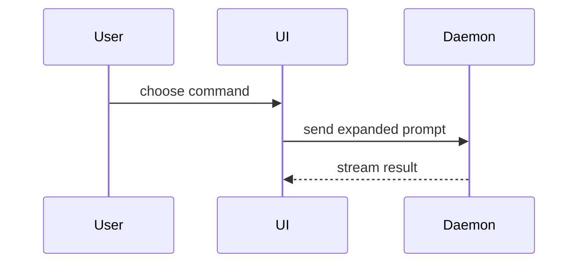

A PR body has two halves. The first half is read by everyone. The second half is read by the reviewer who wants to dig.

```markdown
## What this PR does

- <bullet>
- <bullet>
- <bullet>

## Details

<diagram, diff-sketch, or tree>

## Evidence

- **Before:** <screenshot/output/failing test run>
  **After:** <screenshot/output/passing test run>

## Merge Danger

**Door:** <one-way or two-way>

**Blast Radius:** <one-word description>

<optional: potential ramifications of merge>
```

## What this PR does

Three to six bullets. A reader who stops here knows the whole change.

Write each bullet like a smart engineer talking across a desk: plain English, answer first, one change per bullet, under 15 words. Say the user-visible effect before the mechanism ("The contract panel's scrollbar now follows the theme", then how). Open with the issue ref if there is one (`Fixes #123`).

Prose rules for this section:

- Short word over long word: "fix" over "implement a solution for".
- One idea per sentence, active voice, 20 words max.
- Plain text. Bold and inline code only for a name the reader must search for.
- Every not, never, no, only survives. Clarity beats compression.
- Keep tangents (reverted commits, drive-by test fixes, what is left for another PR) out of this section. They go under Details.

## Details

Everything else lives here, and it may be long. Pick the smallest view that makes the key point clear. Use the user's domain language from `GLOSSARY.md`.

- Show logic or an algorithm as pseudocode:

```text
on(save)
  if content is unchanged
    return cached result
  write new content
  return fresh result
```

- Show runtime control flow as a call tree:

```text
submitForm
  createSession
    persistPrompt
    launchAgent
  navigateToSession
```

- Show UI structure as a component tree, including state and module boundaries that matter:

```text
<SessionPage> (apps/example/src/routes/session.tsx)
  useSessionEvents()
  <SessionToolbar>
    <RunSkillButton> (packages/ui)
```

- Show file responsibility or a broad refactor as a shallow file tree:

```text
src/
├── commands/       # parses user actions
├── sessions/       # owns session state
└── transport/      # sends API requests
```

- Show component interaction, control flow, or data flow with Mermaid:



- Use `diff` when the point is what changes and the surrounding shape already exists. Match the diff shape to the topic: a component tree, a file layout, a call tree, or a control-flow sketch.

```diff
 on(save)
-  write content
+  if content is unchanged
+    return cached result
+  write new content
+  invalidate cache
```

- Show the whole block when most of it is new, when omitted context would hide ownership or order, or when the user needs a copyable target shape.

Place each visual next to the short text it supports. Keep only the calls, files, props, states, and boundaries needed to make the point. You may use one of these, you may use several, it is unlikely you will use all of them.

Tangents go here too, each under its own short sub-heading: a commit that was superseded, a pre-existing failure this PR also repairs, work deliberately left for another PR.

## Evidence

Concrete evidence that the change works. Show a before and after.

Screenshots are S-tier when the environment is set up for it and the change is visual. Execution-based evidence is A-tier: test results, console output. Show the exact test that now fails and passes, using pseudocode.

## Merge Danger

Describe whether it is a one-way or two-way door. You can walk back through two-way doors, but not one-way doors. Changes that involve destructive actions or hard-to-reverse decisions are one-way doors.

The blast radius is the potential scope of the change. Consider all possibilities: layout shift, breakages for consumers, mobile responsiveness.

## Pre-send check

1. Does the first section stand alone? A reader who stops there has the whole picture.
2. Does any bullet in the first section open with context or mechanism instead of the change? Flip it.
3. Did a tangent sneak into the first section? Move it to Details.
